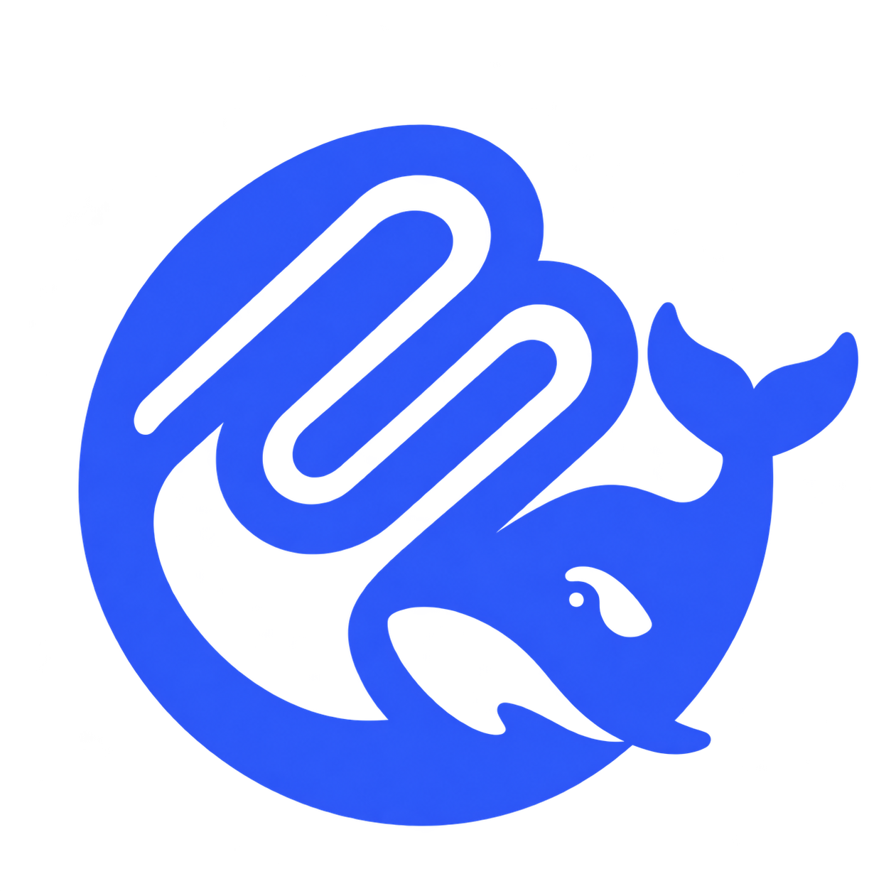

<div align="center">



# DeepSeek Studio

**Give DeepSeek Chat real hands.** A Chrome extension + local bridge that connects [chat.deepseek.com](https://chat.deepseek.com) to any [Model Context Protocol (MCP)](https://modelcontextprotocol.io) server — filesystem, shell, memory, docs and more.

[](CHANGELOG.md)
[](LICENSE)
[](#-requirements)
[](https://developer.chrome.com/docs/extensions/mv3/)

</div>

---

## 📖 What is this?

DeepSeek's web chat can reason about code, but it can't actually _touch_ your machine — it can't read a file, list a directory, or run a command. **DeepSeek MCP Studio** closes that gap.

It is made of two parts:

| Component                    | What it does                                                                                                                                                                         |
| ---------------------------- | ------------------------------------------------------------------------------------------------------------------------------------------------------------------------------------ |
| **Bridge** (`bridge/`)       | A small local server (default `http://localhost:43210`) that spawns your MCP servers over stdio, lists their tools, and proxies tool calls.                                          |
| **Extension** (`extension/`) | A Manifest V3 Chrome extension that injects a tool banner + `@mention` autocomplete into the DeepSeek chat box, renders permission cards, and executes the tools the model asks for. |

When you type a message with an `@mention`, the extension prepends a system prompt describing the available tools. When DeepSeek replies with an MCP call block, the extension shows a card → you approve (or auto-run) → the bridge executes the tool → the result is fed back into the chat, and the model continues.

---

## ✨ Features

- 🔌 **Any MCP server** — filesystem, bash/shell, memory, context7 and anything else that speaks MCP over stdio.
- 🏷️ **`@mention` routing** — type `@filesystem`, `@bash`, or `@` for all tools; a live autocomplete dropdown appears.
- 🟢 **Live server pills** — a floating banner above the chat box shows each server's online status and tool count.
- 🔒 **Permission cards** — dangerous tools (write / execute) require a click; read-only tools are marked safe.
- ⚡ **Auto-run** — toggle one switch to skip the approval card for trusted sessions.
- ⚡ **Slash skills** — type `/review`, `/explain`, `/tests`, `/commit` … to run reusable prompt bundles; add your own in the popup.
- 🧠 **Hot reload config** — edit `mcp-config.json` and the bridge re-syncs instantly.
- 🖥️ **Cross-platform** — runs on Windows, macOS, and Linux.

---

## ⚡ Skills (slash commands)

Skills are reusable prompt bundles triggered with a leading `/name`. Type `/` in the chat box to see an autocomplete list.

| Skill           | What it does                               |
| --------------- | ------------------------------------------ |
| `/help`         | List every available skill                 |
| `/explain`      | Explain code or a concept step by step     |
| `/review`       | Senior code review (bugs, security, style) |
| `/refactor`     | Refactor for readability & maintainability |
| `/tests`        | Write unit tests                           |
| `/debug`        | Find the root cause of a bug + fix         |
| `/commit`       | Write a Conventional Commits message       |
| `/summarize`    | Summarize into bullet points               |
| `/translate-ar` | Translate to Arabic                        |
| `/translate-en` | Translate to English                       |

**Usage:**

```
/review <paste code here>
@bash /explain what does this command do
```

- A skill alone (e.g. `/help`) expands and sends immediately.
- Text after the skill name is appended to the skill prompt.
- Skills combine with `@server` mentions (the tool schema is prepended).

### Custom skills

Open the extension popup → **Skills** tab → fill in a name, emoji, description and prompt → **Add / Update Skill**. Custom skills are stored in `chrome.storage.local` and can override a built-in with the same name. Delete or edit them any time from the same tab.

---

## ✅ Requirements

| Dependency                                  | Version                 | Notes                                                             |
| ------------------------------------------- | ----------------------- | ----------------------------------------------------------------- |
| **[Bun](https://bun.com)**                  | ≥ 1.1 (tested on 1.3.6) | Runtime for the bridge. Can also be installed via `npm i -g bun`. |
| **Node.js**                                 | ≥ 18                    | Only needed if you prefer `npx` for the context7 MCP server.      |
| **Google Chrome** / Chromium / Brave / Edge | Any recent version      | The extension is Manifest V3.                                     |
| **Git**                                     | any                     | To clone the repo.                                                |

> **Windows users:** the built-in `bash` MCP tool (`command-server.js`) runs commands through the system shell. It works out of the box with PowerShell/cmd; a POSIX shell (WSL or Git Bash) is recommended if you rely on Unix commands.

---

## 🚀 Quick Start

### 1. Clone

```bash
git clone https://github.com/domz-1/deepseek-studio.git
cd deepseek-studio
```

### 2. Install bridge dependencies

```bash
cd bridge
bun install
cd ..
```

### 3. Start the bridge

Run it in a terminal and **leave it running** while you use the chat:

```bash
# from the repo root
bun run bridge/server.js
```

You should see:

```
[MCP] filesystem → N tools
[MCP] bash → 1 tools
[MCP Hub running → http://localhost:43210
```

### 4. Load the extension

1. Open `chrome://extensions` (or `brave://extensions`, `edge://extensions`).
2. Enable **Developer mode** (top-right).
3. Click **Load unpacked** and select the `extension/` folder.
4. Pin **DeepSeek MCP Studio** to your toolbar.

### 5. Use it

1. Open [https://chat.deepseek.com](https://chat.deepseek.com).
2. You'll see a banner of **server pills** above the input box.
3. Type a message, e.g.:

   ```
   @filesystem list the files in my projects folder
   ```

4. Press **Enter** → DeepSeek replies with a tool call → a permission card appears → click **✓ Run Now**.
5. The result is posted back and the model continues automatically.

---

## 🧩 Platform Setup

### 🐧 Linux

```bash
# Install Bun
curl -fsSL https://bun.com/install | bash

# Clone & install
git clone https://github.com/domz-1/deepseek-mcp-ext.git
cd deepseek-mcp-ext/bridge && bun install && cd ..

# Run
bun run bridge/server.js
```

Use the helper script:

```bash
chmod +x scripts/install-linux.sh
./scripts/install-linux.sh
```

#### Run as a Background Service (systemd)

To keep the bridge running silently in the background on startup (no open terminal needed):

```bash
# 1. Create user systemd service
mkdir -p ~/.config/systemd/user
cat << 'EOF' > ~/.config/systemd/user/deepseek-mcp.service
[Unit]
Description=DeepSeek MCP Bridge Hub Daemon
After=network.target

[Service]
Type=simple
WorkingDirectory=%h/projects/adham/deepseek-mcp-ext/bridge
ExecStart=%h/.bun/bin/bun run server.js
Restart=always
RestartSec=3
Environment=PATH=%h/.bun/bin:/usr/local/bin:/usr/bin:/bin

[Install]
WantedBy=default.target
EOF

# 2. Enable and start immediately
systemctl --user daemon-reload
systemctl --user enable --now deepseek-mcp.service

# 3. Check status
systemctl --user status deepseek-mcp.service
```

### 🍎 macOS

```bash
# Install Bun (Homebrew)
brew install oven-sh/bun/bun
# …or: curl -fsSL https://bun.com/install | bash

# Clone & install
git clone https://github.com/domz-1/deepseek-studio.git
cd deepseek-studio/bridge && bun install && cd ..

# Run
bun run bridge/server.js
```

Use the helper script:

```bash
chmod +x scripts/install-macos.sh
./scripts/install-macos.sh
```

> macOS may ask for **Full Disk Access** for Terminal if you want the filesystem server to read protected folders (Desktop, Documents, Downloads). Grant it in **System Settings → Privacy & Security**.

### 🪟 Windows

**Option A — PowerShell (recommended)**

```powershell
# Install Bun
powershell -c "irm bun.sh/install.ps1 | iex"

# Clone & install
git clone https://github.com/domz-1/deepseek-studio.git
cd deepseek-studio\bridge
bun install
cd ..

# Run
bun run bridge/server.js
```

Use the helper script (right-click → _Run with PowerShell_, or from a terminal):

```powershell
powershell -ExecutionPolicy Bypass -File .\scripts\install-windows.ps1
```

**Option B — Git Bash / WSL** — follow the Linux instructions inside the shell.

> **Windows path note:** paths in `bridge/mcp-config.json` use forward slashes or escaped backslashes. The example config ships with Linux paths — replace them with your own, e.g. `"C:/Users/YourName/projects"`.

---

## ⚙️ Configuration

The bridge reads `bridge/mcp-config.json`:

```jsonc
{
  "mcpServers": {
    "filesystem": {
      "command": "bunx",
      "args": [
        "@modelcontextprotocol/server-filesystem",
        "/home/you/projects", // ← add your allowed roots here
      ],
      "enabled": true,
    },
    "bash": {
      "command": "bun",
      "args": ["./command-server.js"],
      "enabled": true,
    },
    "memory": {
      "command": "bunx",
      "args": ["@modelcontextprotocol/server-memory"],
      "enabled": true,
    },
  },
}
```

- Set `"enabled": false` to disable a server without deleting it.
- You can edit this file from the **extension popup**, or edit it on disk and the bridge will re-sync on the next `POST /mcp`.
- `command` / `args` / `env` follow the standard MCP server launch format.

### Bridge HTTP API

| Method | Path    | Purpose                                                          |
| ------ | ------- | ---------------------------------------------------------------- |
| `GET`  | `/mcp`  | Return current config, server status, and the full tool list.    |
| `POST` | `/mcp`  | Replace the config and hot-reload all servers.                   |
| `POST` | `/call` | Execute a tool: `{ "name": "read_file", "arguments": { ... } }`. |

The port is `43210` by default (change `PORT` in `bridge/server.js` if it conflicts).

---

## 🏗️ Project Structure

```
deepseek-mcp-ext/
├── assets/
│   └── icon.png              # Extension / repo logo
├── bridge/
│   ├── server.js             # MCP hub (Express + MCP SDK)
│   ├── command-server.js     # Built-in bash/shell MCP server
│   ├── mcp-config.json       # Server definitions
│   ├── package.json
│   └── run.sh
├── extension/
│   ├── manifest.json         # Manifest V3
│   ├── background.js         # Service worker (fetch to bridge)
│   ├── skills.js             # Skills engine (built-ins + storage)
│   ├── content.js            # @mention + /skill UI, cards, tool execution
│   ├── popup.html
│   ├── popup.js
│   └── icon.png
├── scripts/
│   ├── install-linux.sh
│   ├── install-macos.sh
│   └── install-windows.ps1
├── CHANGELOG.md
├── LICENSE
└── README.md
```

---

## 🩺 Troubleshooting

| Symptom                         | Fix                                                                                                           |
| ------------------------------- | ------------------------------------------------------------------------------------------------------------- |
| Banner shows `0` tools          | Make sure the bridge is running: `curl http://localhost:43210/mcp`. Check the terminal for `[MCP ERR]` lines. |
| `Tool … not found`              | The server that provides it is disabled or failed to start. Re-check `mcp-config.json`.                       |
| Extension does nothing          | Reload it in `chrome://extensions`, then refresh the DeepSeek tab.                                            |
| `EADDRINUSE :43210`             | Another bridge instance is running — kill it, or change `PORT` in `server.js`.                                |
| Filesystem server sees no files | Add the folder to the `args` array in `mcp-config.json` (each path = one allowed root).                       |
| Commands fail on Windows        | Use PowerShell-compatible commands, or run the bridge inside WSL/Git Bash for Unix tools.                     |

---

## 🤝 Contributing

1. Fork the repo.
2. Create a branch: `git checkout -b feat/my-feature`.
3. Commit: `git commit -m "feat: add my feature"`.
4. Push and open a Pull Request.

---

## 📄 License

[MIT](LICENSE) © domz-1 (Adham)

---

<div align="center">
<sub>Built with Bun + the Model Context Protocol SDK. Not affiliated with DeepSeek.</sub>
</div>
